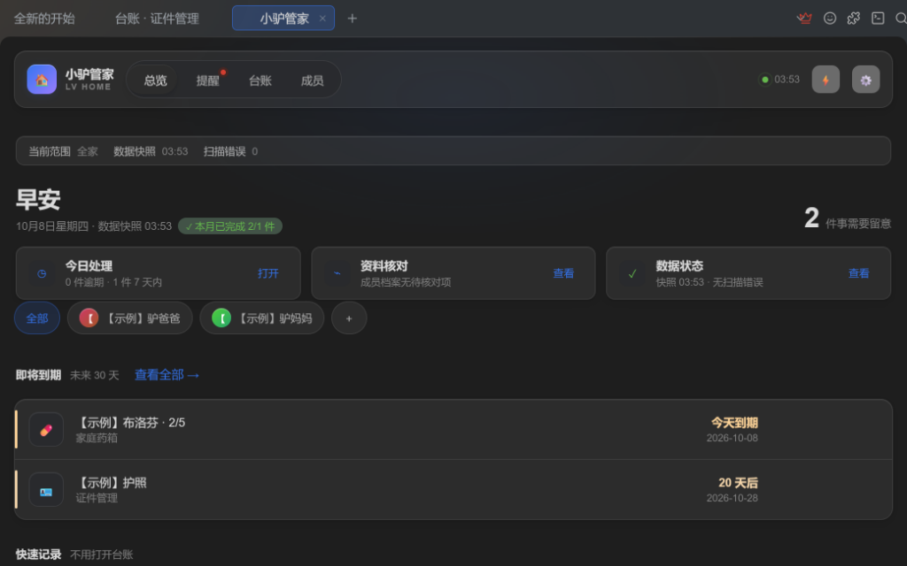

<div align="center">


# 🏠 小驴管家 · Lv Home

**思源笔记里的全天候家庭生活管家与到期中枢**

家庭私有资料沉淀 · 成员中心视角 · 客观规则衍生提醒 · 闭环业务办理

**当前版本：v0.5.195** ｜ [English Documentation](./README.en.md) ｜ [更新日志](./CHANGELOG.md)

[](https://github.com/xiaolv-suite/siyuan-home/actions/workflows/ci.yml)
[](./CHANGELOG.md)
[](https://b3log.org/siyuan)
[](./LICENSE)

[⬇️ 下载安装](#-兼容宿主版本与安装方式) · [🚀 快速上手](#-三步快速上手first-3-minutes) · [🖥️ 面板用途](#-各主要面板用途) · [⚙️ 设置参考](#-设置项全景说明含默认值与影响) · [⌨️ 快捷键](#-快捷键速查表) · [🔒 隐私说明](#-数据存放位置与隐私声明)

<br/>



</div>

---

## 🎯 为什么需要小驴管家？它解决什么问题？

在快节奏的生活中，个人的证件卡券、家人的健康用药、资产维保与周期缴费往往散落各处：微信收藏、手机备忘录、实体抽屉或者脑海里。**不记容易忘，纯手工记账又繁琐难以坚持。**

| 痛点场景 | 传统外部工具 / 手工备忘局限 | 小驴管家解决方案 |
| :--- | :--- | :--- |
| **证件与资质临期** | 护照、驾照、身份证不知不觉过期，临到办事买票才发现寸步难行 | **客观规则自动推演**：录入一次有效期限，系统自动在到期前 90/30/7 天分梯级派生预警 |
| **家庭健康与药箱管理** | 处方药吃完了才发现早过了有效期，或者重复购买囤积浪费 | **药品有效期预警与库存追踪**：开封有效期自动折算，用药备忘与过敏禁忌与成员档案深度绑定 |
| **车辆年检与保险续期** | 车险保单、年检到期未续被扣分扣款，保养间隔模糊不清 | **车辆全生命周期管理**：保养里程/时程双轨提醒，保险单据、违章记录与加油能耗台账一体化 |
| **会员与自动续费扣款** | 各类 App 自动续费、信用卡年费默默扣款数月却浑然不觉 | **周期支出与订阅雷达**：计划日固定循环 vs 实际扣款日顺延，扣款日前主动推送通知 |
| **长辈生辰与亲属档案** | 长辈农历生辰记不清，全家疫苗接种周期繁琐易漏 | **成员中心全景视角**：农历公历双轨自动推演，从“人”的维度穿透聚合其全部证件、健康与待办 |
| **找东西翻箱倒柜** | 备用钥匙、发票、实体合同随手一放，用时翻箱倒柜 | **物品存放位置反向索引**：输入“收纳箱”或“书房”，该区域存放的所有物品清单一目了然 |

小驴管家不要求你每天繁琐手工记账，而是通过**“录入一次事实，系统自动派生全流程预警”**的闭环机制，让全家重要资料始终井井有条。

---

## 🌟 核心功能清单

| 核心领域 | 关键功能与特性 | 用户实际价值 |
|---|---|---|
| **🏠 全景总览** | Bento 风格深色重音看板、周律动脉冲条（Weekly Pulse）、家庭成就达标、成员专属视角快速切换、日常流水优先直达 | 每日进入即刻掌握全家今日需办紧急事项，一眼扫清核心风险 |
| **⏰ 到期提醒中枢** | 双日期驱动模型（客观截止日 vs 主观计划日）、双基准循环（计划日固定循环 vs 实际完成日顺延）、一键梯度推迟、列表与原生日历网格双模、一键复制标准家庭群通知、原生日历离线导出 iCalendar (.ics)、命名视图保存与周报 Markdown | 彻底根除逾期；家庭待办一键分发群通知；与 iOS/Android 系统日历无缝导入同步 |
| **🗂️ 31 类家庭台账** | 覆盖证件、车辆、健康、保险、药箱、资产、合同、家务等 31 类场景；虚拟滚动高性能表格、表头列宽鼠标拖拽调整与记忆持久化、多列排序、全字段筛选与拼音即时搜索 | 格式化沉淀事实；列宽自适应随心拖拽；思源原生属性视图可直接在正文中引用嵌入 |
| **👥 成员档案中心** | 家庭角色树（本人、配偶、子女、长辈、宠物）、头像本地存储、公农双历生日自动推演公历到期日、「一家人一起」多成员一键全选、成员资料一键穿透汇总、vCard 通讯录导出 | 从“人”的维度检索其全部证件、资产、体征与待办，穿透零遗漏 |
| **🔍 全景生活检索** | 全局 `Ctrl+K` 快速唤出，预载拼音模糊索引，支持 `#标签` 与 `!紧急` 高级过滤语法、关键字 `<mark>` 标亮与键盘流式导航 | 3 秒内秒级定位任何生活条目、证件号码或物品存放位置 |
| **⚡ 极速随手记录** | 全局 `N` 键一键呼出，补能三数智能换算与动态面额、支持 Quick Add 语法标记（`@明天` / `@+3d`、`!高/!中/!低`、`#分类`、`*每月` / `*!14天`）与自然语言日期智能解析 | 灵感与事务即刻捕捉，记忆引擎自动复用常用参数，无需打断当前工作流 |
| **📍 物品存放速查** | 跨模块物品存放位置动态索引，支持按“书房、主卧、收纳箱、车库”反向检索物品 | 告别翻箱倒柜，“东西放哪了”一搜即得 |
| **🤝 小驴生态联邦联动** | 深度集成小驴打卡（习惯打卡）、小驴人脉（个人互动沉淀）、小驴拾遗（合同伴读切片）、小驴雷切（工作台组件与快捷动作），100% 优雅降级 | 零摩擦融入小驴系列插件矩阵，未安装时完全自洽无感，零报错零打扰 |
| **🛡️ 隐私与安全工具** | 访客展示安全脱敏模式（Guest Mode）、家庭急救卡（含血型/过敏/紧急联络）、年度生活盘点图、台账安全回收站 | 对外展示一键隐藏敏感数字与证件；突发险情一键展示急救生命体征；误删无损撤销还原 |

---

## 🚀 三步快速上手（First 3 Minutes）

1. **第一步：建立家庭成员**
   打开小驴管家，点击底部导航的「成员」进入成员中心。系统默认已创建“本人”档案，点击右上角「＋ 添加成员」，录入配偶、孩子或父母的姓名与生日。如果是农历生日，直接勾选「农历」，系统每年会自动推演对应的公历提醒日。
2. **第二步：录入第一张重要证件**
   点击顶部导航「台账」 -> 选择左侧「证件资料」分类 -> 点击右上角「＋ 新增」，录入身份证或护照的有效截止日期。保存后，系统将自动派生一条到期规则，并在提醒看板中按需提前预警。
3. **第三步：日常查看与随手记**
   日常使用中，按快捷键 `Alt + H`（或点击顶栏小房子图标）唤出总览看板，一眼掌握近期需处理的到期提醒；遇到需要随手记录的支出或事务，按下快捷键 `N` 即可唤起快速记录浮窗。

---

## 🖥️ 各主要面板用途

小驴管家采用清晰的双层导航架构：顶部为主业务域切换，底部为主功能视口切换。

```
┌─────────────────────────────────────────────────────────────┐
│  小驴管家 Lv Home                                            │
│  [ 总览 ]  [ ⏰ 提醒 ]  [ 🗂️ 台账 ]  [ 👥 成员 ]  [ ⚙️ 设置 ]   │
│ ─────────────────────────────────────────────────────────── │
│                                                             │
│                    主 作 业 画 布 区                         │
│                                                             │
│ ─────────────────────────────────────────────────────────── │
│  [快捷搜索 Ctrl+K]               [快速记账 N]   [访客模式 G] │
└─────────────────────────────────────────────────────────────┘
```

| 面板 | 对应功能 | 核心用途与场景 |
|---|---|---|
| **🏠 总览** | 全景看板与今日聚焦 | 汇聚今日必办、本周脉冲、紧急到期与资产概览，每天早晨扫一眼即可 |
| **⏰ 提醒** | 到期规则与日程调度 | 集中查看所有派生的待办与到期提醒，支持列表/日历双视图，可一键推迟或完成 |
| **🗂️ 台账** | 31 类结构化事实数据库 | 证件、车辆、保险、药品、资产、合同等分类台账，支持列宽拖拽、高级筛选与数据导出 |
| **👥 成员** | 成员中心与个人全景 | 以“人”为轴心查看专属证件、用药与待办，支持家庭角色树与通讯录导出 |
| **⚙️ 设置** | 系统偏好与数据安全 | 配置通知方式、提醒提前期、Webhook 推送、数据备份导出与访客脱敏规则 |

---

## ⚙️ 设置项全景说明（含默认值与影响）

小驴管家提供开箱即用的默认配置，同时支持根据个人习惯微调：

| 分区 | 配置项 | 配置路径 | 默认值 | 业务影响与推荐说明 |
|---|---|---|:---:|---|
| **基础偏好** | 默认主页 | `settings.defaultView` | `overview` | 插件打开时优先展示的面板，推荐保持 `overview`（总览）以快速聚焦今日待办 |
| **基础偏好** | 货币符号 | `settings.currencySymbol` | `¥` | 台账中金额字段的展示符号，可改为 `$`、`€` 或 `£` |
| **到期提醒** | 默认提前提醒天数 | `settings.reminderAdvanceDays` | `30` | 新建规则时默认采用的提前预警期（天），支持 7/15/30/60/90 等灵活阶梯 |
| **到期提醒** | 每日提醒触发时刻 | `settings.reminderCheckTime` | `09:00` | 每天自动扫描到期规则并弹出系统通知的时刻，建议设为早晨上班时间 |
| **到期提醒** | 静默免打扰时段 | `settings.quietHours` | `22:00-08:00` | 该时间段内禁止发出任何声音提示与强提醒弹窗，保障夜间休息 |
| **表格偏好** | 表格行高密度 | `settings.tableDensity` | `compact` | `compact`（紧凑）每屏展示更多数据，`comfortable`（舒适）触控更友好 |
| **表格偏好** | 自动记忆列宽 | `settings.persistColumnWidths` | `true` | 鼠标拖拽表头调整列宽后是否自动记住，推荐开启 |
| **隐私安全** | 访客脱敏模式 | `settings.guestMode` | `false` | 开启后（或按快捷键 `G`）自动打码证件号码、资产金额与敏感备注 |
| **外部通知** | Webhook 地址 | `settings.webhookUrl` | 空 | 可选配置企业微信/飞书/钉钉群机器人 Webhook，实现关键提醒推送到手机群聊 |

---

## ⌨️ 快捷键速查表

| 快捷键 | 功能操作 | 适用上下文 | 说明 |
|---|---|---|---|
| `Alt + H` | 唤出 / 收起小驴管家主面板 | 思源全局任意位置 | 极速切换，不影响当前正在编辑的笔记 |
| `Ctrl + K` | 唤起全局生活检索 | 小驴管家窗口内 | 支持拼音首字母模糊匹配与 `#标签` 过滤 |
| `N` | 唤起快速随手记浮窗 | 小驴管家窗口内 | 快速录入一笔支出、备忘或事项，按 `Enter` 提交 |
| `G` | 切换访客脱敏模式 | 小驴管家窗口内 | 快速遮盖敏感资产与证件号，对外演示时使用 |
| `1` ~ `5` | 切换顶部导航 Tab | 小驴管家窗口内（非输入状态） | 1=总览，2=提醒，3=台账，4=成员，5=设置 |
| `Esc` | 退出当前弹窗或关闭面板 | 任意对话框 / 浮窗 | 遵循标准模态返回栈，按层级安全退出 |
| `?` | 呼出快捷键帮助列表 | 小驴管家窗口内 | 查看当前界面的全部交互快捷键 |

---

## ❓ 常见问题与故障排查（FAQ）

- **Q1：我的数据保存在哪里？换电脑怎么迁移？**  
  **答：** 所有数据 100% 保存在思源工作空间本地目录 `data/storage/petal/siyuan-home/` 下，绝不上云。换电脑时，只需使用思源自带的同步功能，或者在插件「设置」 -> 「数据备份」中点击「导出完整备份包 (.json)」，在新设备上一键导入即可。
- **Q2：为什么设置了到期提醒，没有收到系统弹窗？**  
  **答：** 请检查三点：1) 思源笔记是否处于运行状态；2) 插件「设置」中的「每日提醒触发时刻」是否已过；3) 检查操作系统的通知权限是否允许思源笔记发送桌面通知。
- **Q3：如何将小驴管家的数据嵌入到思源笔记的正文中？**  
  **答：** 小驴管家为每一张台账都建立了与思源原生属性视图（Attribute View）相兼容的数据结构。你可以在任意笔记中输入 `/` 插入对应块引用，实现“左边是生活台账，右边是知识笔记”的双向打通。
- **Q4：可以有多个人同时协同编辑管家数据吗？**  
  **答：** 小驴管家基于思源笔记的单用户本地数据库架构。如果家庭成员都需要查看，推荐使用思源笔记官方的 Docker 部署方案或局域网伺服模式，全家通过浏览器共同访问同一个思源工作空间。

---

## 🔒 数据存放位置与隐私声明

小驴管家遵循严格的 **Local-First（本地优先）** 架构设计：

- **数据绝对私有**：所有家庭成员资料、证件信息、台账明细与到期提醒，全部以标准 JSON 文件存放在思源工作空间目录：
  ```
  data/storage/petal/siyuan-home/
  ├── store.json             # 核心台账与规则数据库
  ├── members.json           # 家庭成员资料与角色关系
  ├── settings.json          # 系统偏好与显示配置
  └── views.json             # 用户保存的自定义筛选视图
  ```
- **零遥测与外部网络**：插件不含任何第三方埋点、数据统计或追踪 SDK。除非用户显式配置了自定义 Webhook 地址用于个人消息推送，插件绝不主动向任何外部服务器发送字节。
- **数据随时可搬走**：支持一键导出标准 JSON 备份包与 CSV/iCalendar 通用格式，随时无损迁移。

---

## 📦 兼容宿主版本与安装方式

- **兼容版本**：**思源笔记 >= v3.8.4**（已全面适配桌面端 Windows / macOS / Linux 以及 Android / iOS 移动端）

> **内测说明**：当前 `plugin.json` 为 `disabledInPublish: true`，尚未在思源集市上架；请使用下方本地安装方式，集市入口将在内测转正后开放。

### 方式一：发行包手动安装（内测推荐）
1. 从 [GitHub Releases](https://github.com/xiaolv-suite/siyuan-home/releases/latest) 下载最新版的 `package.zip`（或使用本地 `pnpm build` 生成的包）；
2. 将压缩包解压至思源工作空间目录：`data/plugins/siyuan-home/`；
3. 重启思源笔记，在「设置」 -> 「插件」中开启即可。

### 方式二：源码构建与本地安装
1. 环境要求：Node.js `>= 24.0.0`、pnpm `12.x`；
2. 在仓库根目录执行 `pnpm install && pnpm build`；
3. 执行 `pnpm make-install`（或 `pnpm make-link` 建立开发软链）。

### 方式三：思源集市（内测转正后开放）
当前版本尚未上架，集市搜索不到属预期；上架后此处会更新为推荐方式。

---

## 🐴 小驴系列插件家族

小驴系列插件各自独立，可按需安装和组合使用：

| 插件名称 | 一句话简介 | GitHub 仓库 |
| :--- | :--- | :--- |
| [小驴雷切](https://github.com/xiaolv-suite/siyuan-speed-switch) | 思源中的统一导航与工作上下文平台，连接页签、工作台、片段和快捷入口。 | [xiaolv-suite/siyuan-speed-switch](https://github.com/xiaolv-suite/siyuan-speed-switch) |
| [小驴打卡](https://github.com/xiaolv-suite/siyuan-checkin) | 本地优先的习惯、目标打卡与复盘工作台。 | [xiaolv-suite/siyuan-checkin](https://github.com/xiaolv-suite/siyuan-checkin) |
| [小驴人脉](https://github.com/xiaolv-suite/siyuan-contacts) | 在思源中管理联系人、人际关系、组织归属和重要日期。 | [xiaolv-suite/siyuan-contacts](https://github.com/xiaolv-suite/siyuan-contacts) |
| [小驴拾遗](https://github.com/xiaolv-suite/siyuan-glean) | 整理思源剪藏和导入文章，支持状态分拣、阅读管理与日后回顾。 | [xiaolv-suite/siyuan-glean](https://github.com/xiaolv-suite/siyuan-glean) |
| [小驴考试（内测版）](https://github.com/xiaolv-suite/siyuan-exam) | 本地题库备考工作台，支持多格式导入、刷题、模考、错题复盘与 AI 辅助。 | [xiaolv-suite/siyuan-exam](https://github.com/xiaolv-suite/siyuan-exam) |
| [小驴管家（内测版）](https://github.com/xiaolv-suite/siyuan-home) | 管理家庭与生活资料、成员档案、台账、到期提醒和事务跟进。 | [xiaolv-suite/siyuan-home](https://github.com/xiaolv-suite/siyuan-home) |
| [小驴闪卡（内测版）](https://github.com/xiaolv-suite/siyuan-lv-cards) | 思源中的知识捕获、制卡、练习与复习平台，使用内核原生 FSRS 排期。 | [xiaolv-suite/siyuan-lv-cards](https://github.com/xiaolv-suite/siyuan-lv-cards) |
| [小驴常用（内测版）](https://github.com/xiaolv-suite/xiaolv-common) | 基于思源块保存、搜索并快速调用常用语、模板、代码和链接，支持变量填充。 | [xiaolv-suite/xiaolv-common](https://github.com/xiaolv-suite/xiaolv-common) |

交流与反馈 QQ 群：**871707735**（可反馈 Bug、提交需求和交流使用体验）。

---

## 📝 最近更新动态

- **思源 3.8.10+ 原生特性适配**：家庭成员头像支持右键通过 `openNativeAssetPicker` 直接选用库内图片；台账成员卡片与提醒任务项支持右键直通原生文档树菜单（`showDocTreeNativeMenu`）。
- **输入法合成期守护**：行内编辑保存与聚焦搜索（Spotlight）的 Enter/ArrowDown 键盘流在拼音候选合成期整体让路，不再以拼音半成品误保存或误导航。
- **资源与内存健壮性**：AI 体检报告复制补齐失败捕获与双语错误提示；年度名片预览图 Blob URL 解码后即刻回收防内存累积；全生态剪贴板写入失败覆盖率契约固化。
- **双端体验打磨**：Spotlight 与工具栏输入框 16px 字号防 iOS 聚焦自动放大；屏幕容器平滑内边距消除贴边感；视口与快速记录滚动监听全面 passive 降负。

<details>
<summary>展开查看历史版本更新（v0.5.194 及更早版本 · 完整记录见 <a href="./CHANGELOG.md">CHANGELOG.md</a>）</summary>

### v0.5.194（2026-11-10 · GitHub 组织迁移与体验升级）

- **顶栏罗盘性能升级**：启动收敛微任务防抖（8 插件并发启动 DOM 重绘 8 次 → 1 次）、思源云同步/重启后顶栏图标 MutationObserver 持久自愈；
- **移动端全屏退场闭环**：打开台账文档自动收起管家全屏面板（`openMobileFileById` 分流），彻底杜绝“文档打开在底层被遮挡”问题；
- **软键盘防误关四重防线**：全屏宿主下拉关闭手势加入输入焦点/表单容器/软键盘三重豁免，严格限定顶栏把手起始；
- **即时轻触感反馈**：快速记录保存与连续记录加入触感振动（`haptic`）与实时入账微胶囊；
- **i18n 补齐**：新增 `hub.mobileFilter` / `hub.mobileFilterAndOps` 语言键；
- **仓库迁移**：GitHub 仓库与提交身份迁移至 `xiaolv-suite` 组织。

<details>
<summary>展开查看历史版本更新（v0.5.193 及更早版本 · 完整记录见 <a href="./CHANGELOG.md">CHANGELOG.md</a>）</summary>

### v0.5.193（2026-11-04）

- 全生态统一基础设施（Epoch 7 Protocol v1.1.0）、AI 网关深度协同、模态弹窗全局键盘治理与 20 步全链路自动化实测通过。

### v0.5.192（2026-11-01）

- 事项与循环引擎全链路优化、日历多选视图与全景检索提速。

</details>

---

## 📄 许可证 (License)

[MIT License](LICENSE) · Copyright (c) 2024-2026 xiaolv-suite
